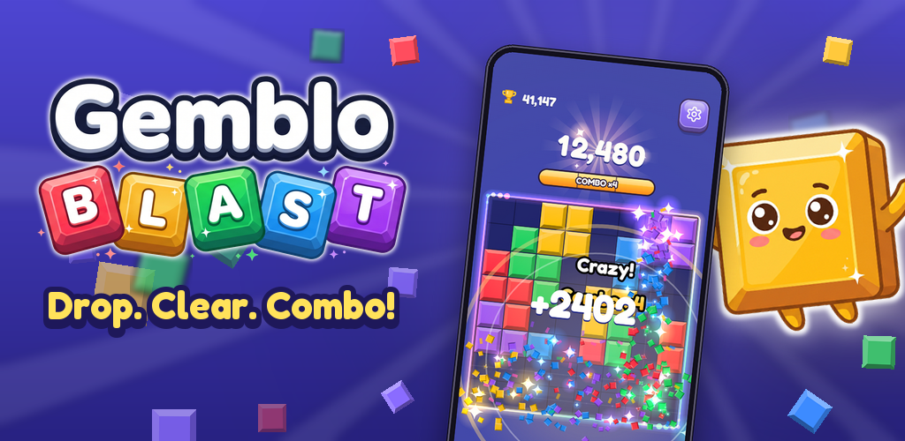
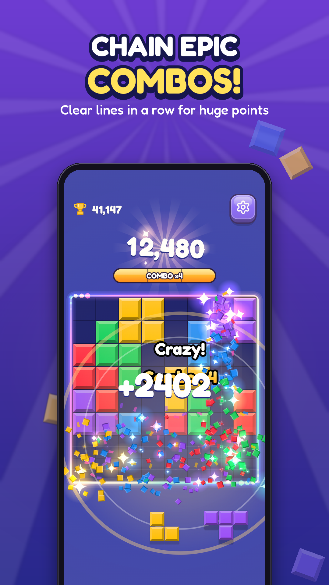
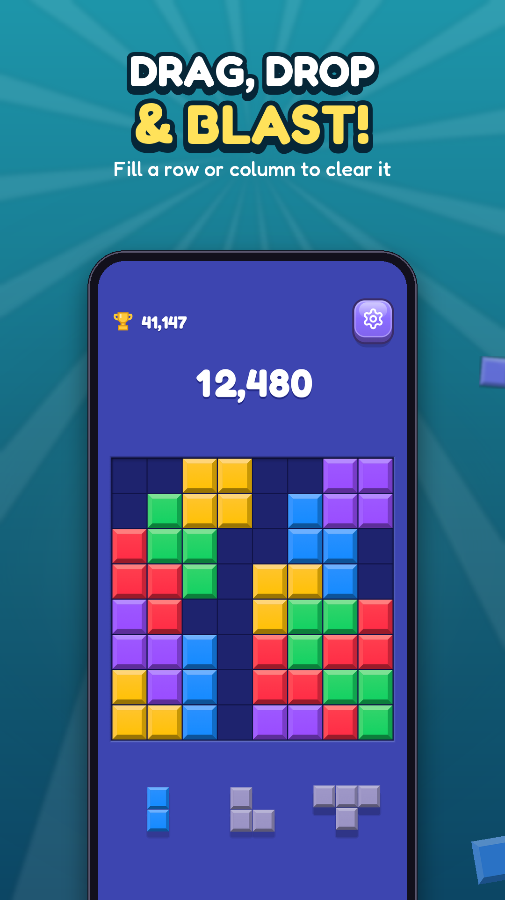
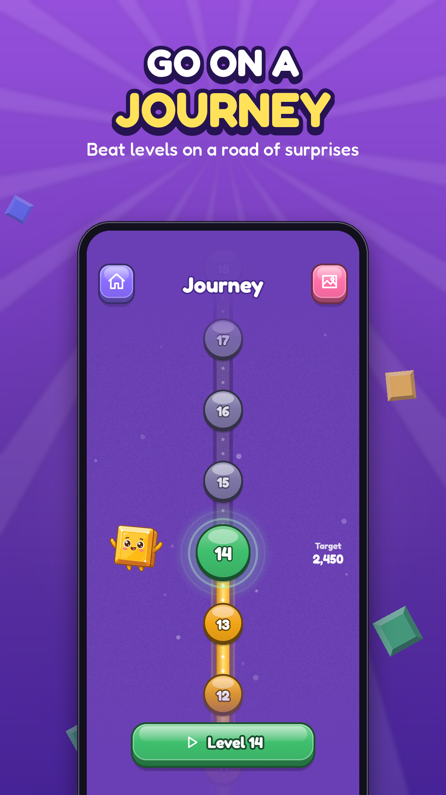
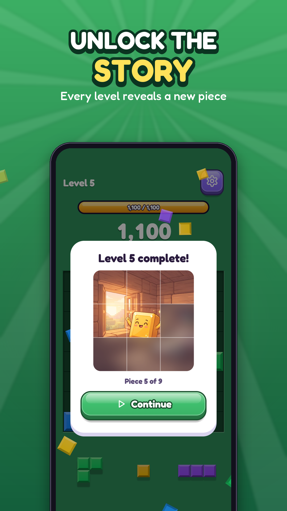
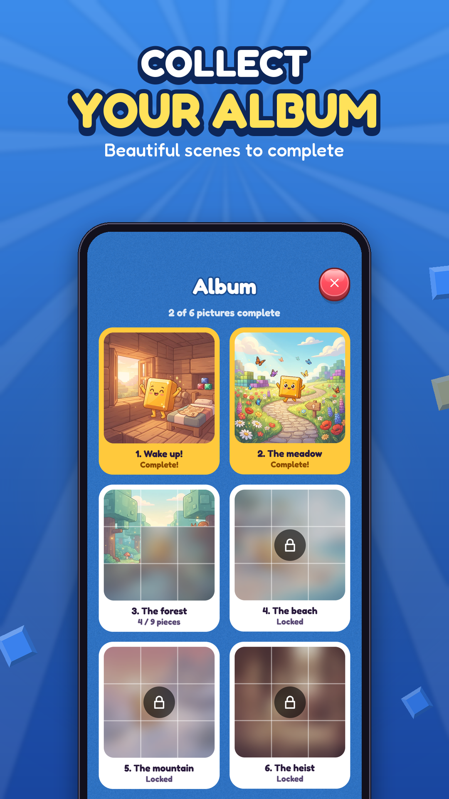
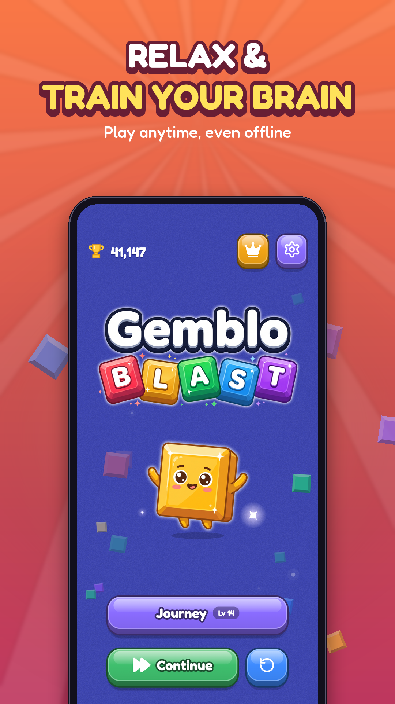

<p align="center">
  
</p>

<h1 align="center">Gemblo Blast</h1>

<p align="center">
  <b>A juicy, calm 8×8 block puzzle with a story to uncover.</b><br>
  Drop pieces, clear lines, chain huge combos, and travel with Goldie through a road of levels that colors in a picture book as you go.
</p>

<p align="center">
  
  
  
</p>
<p align="center">
  
  
  
</p>

## Why it's fun

- **One more move, every time.** Fill a row or column and it bursts. Clear again within three moves and the combo keeps climbing.
- **Combos you can feel.** Every step of a combo plays the next note of a little melody. The grid's border lights up in a flowing rainbow, the score counts up in gold, and a voice cheers *Excellent! Amazing! Crazy! Insane!*
- **Color Flush.** Clear a line made of one single color for a big bonus.
- **Journey mode.** A road of levels, each with a target score and a messy starting board. Every level passed reveals one piece of a 3×3 story picture. Nine levels finish a picture, and each one goes into the **Album**.
- **A friend along the way.** Goldie, the golden block, cheers your best scores, sulks when you run out of space, and waits for you on the road.
- **Calm by design.** Soft piano, gentle reminders to take a break, and no timers. Play anytime, even offline.

## Two ways to play

| **Classic** | **Journey** |
|---|---|
| Endless, chase your best score. Your game is saved, so you can continue later. | Level by level up a road. Reach the target, unlock a story piece, fill the Album. Story chapters: *Wake up! · The meadow · The forest · The beach · The mountain · The heist*, with more coming. |

## Business model

Free to play, with ads kept fair:

- A banner during play, and an ad **between** games. Never mid-game, and none in a player's first 10 games.
- An optional **reward video** to revive once per game.
- **No Ads** one-time purchase ($3.99 via Google Play Billing). It removes every ad, makes the revive free and instant, and shows a Premium crown.

## Built with

- **Kotlin + Jetpack Compose**: every block, effect and popup is drawn in code on a Compose Canvas, at a steady 60 fps.
- **Google AdMob** (banner, interstitial, rewarded) with Google's consent form (UMP).
- **Google Play Billing** for the No Ads purchase, restored automatically on reinstall.
- **WorkManager** for the daily reminder notification.
- Sound: recorded effects (Pixabay) plus effects and music synthesized in code.

## Build

Requirements: JDK 17 and the Android SDK (put its path in `local.properties` as `sdk.dir=...`; this file is not committed).

```
./gradlew installDebug        # debug build on a connected device (package com.papercranelabs.gemblo.debug)
./gradlew testDebugUnitTest   # game rule tests
```

Debug builds always use Google's public **test** AdMob ids, and the No Ads button is a free toggle (the debug app is not on Google Play). Release builds refuse to build until the real AdMob ids are filled in at the top of `app/build.gradle.kts`. Signing keys are never stored in this repo.

**Store screenshots** are real captures from a debug build: `adb shell am start -n com.papercranelabs.gemblo.debug/com.papercranelabs.gemblo.MainActivity --es showcase combo` sets up a scene (`board`, `combo`, `reveal`, `journey`, `album`, `home`). Then `python store-graphics/make_store.py` builds the feature graphic and the framed screenshots.

## Project layout

- `game/Game.kt`: the rules (board, pieces, scoring, combos, Color Flush, fair piece dealing, Journey starting boards)
- `GameUi.kt`: game and screen state, Journey progress, ads and purchase flow, effects bookkeeping
- `GameScreen.kt`: all drawing: board, blocks, effects, Home, the Journey road, Album, popups, studio splash
- `Sound.kt`: sound effects and music (recorded files in `res/raw` plus synthesized ones)
- `ads/AdManager.kt`, `billing/Store.kt`, `Reminders.kt`, `Haptics.kt`, `Juice.kt`, `Icons.kt`
- `store-graphics/`: Google Play feature graphic and screenshots
- `tools/`: art helpers (app icon, cutouts, glows)

Look and feel rules are in [DESIGN.md](DESIGN.md).

## Licenses and credits

- Code: all rights reserved, PaperCrane Labs.
- Font: Fredoka, SIL Open Font License 1.1, see [licenses/Fredoka-OFL.txt](licenses/Fredoka-OFL.txt).
- Sounds: see [licenses/SOUNDS.md](licenses/SOUNDS.md) (Pixabay Content License).
- Art: story pictures and mascot made by the owner; icon credits in [licenses/ART.md](licenses/ART.md).
- Gear icon outline: from Lucide (ISC license).
- App icon: original, drawn from code by `tools/make_icon.py`.

<p align="center"><sub>Made by <b>PaperCrane Labs</b></sub></p>
